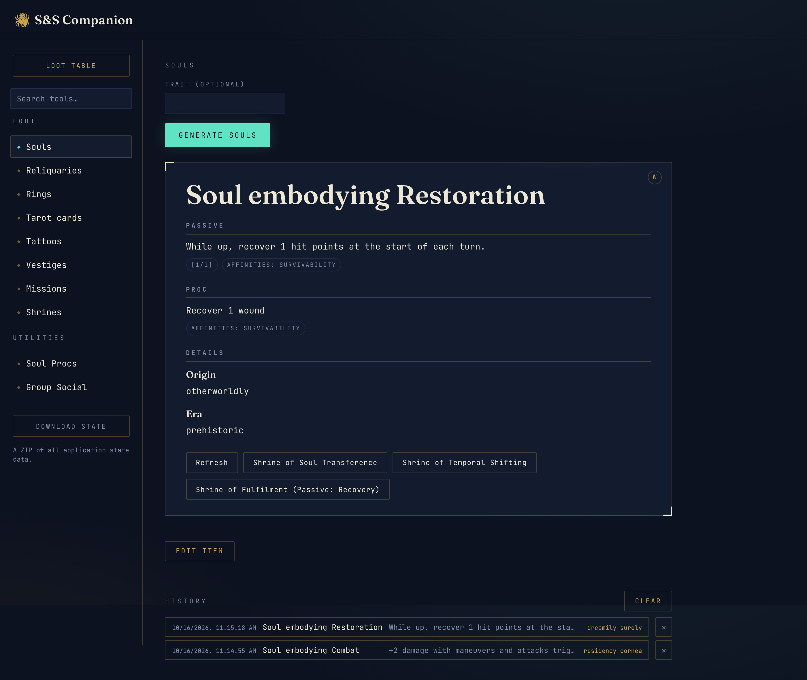

[](https://github.com/spies-and-spiders/companion/actions/workflows/check.yaml)
[](https://central.sonatype.com/artifact/tools.spies/sns-companion-sdk)

# S&S Companion

A loot generator for the DM's side of the table. Run it on your laptop during a
session, open it in a browser, and press a button whenever the party earns
something: a magic ring, a relic that grows stronger over the campaign, the
weather on the road ahead, or anything else your game hands out at random.



The Companion doesn't come with your campaign's content; you bring it. Each kind of
loot is a **tool** you describe in a config file, and a tool can be as simple as
a list of items to pick from or as involved as a program you wrote yourself.

- **Roll the loot table.** Enter a d100 roll (or let the app roll it) and get
  whatever that number lands on.
- **Tweak before you reveal.** Every result can be edited in place. Change a
  damage type or a bonus and the surrounding text updates.
- **Loot that remembers.** Items can be stored and upgraded later in the
  campaign, and the DM can keep tables of their own, such as a roster of
  characters and their bonuses.
- **Keep a record.** Results go into a per-tool history, and can be sent to a
  Discord channel with one click.
- **Bring your own rules.** Write loot as data (EDN or JSON) or in any
  programming language, without touching the app itself.

## Getting it

Download a build for your platform from the
[releases page](https://github.com/spies-and-spiders/companion/releases), or run the
install script:

```sh
curl -fsSL https://raw.githubusercontent.com/spies-and-spiders/companion/master/scripts/install.sh | bash
```

Then write a `config.edn`, run `./companion`, and open <http://localhost:8080>.
[Getting started](docs/getting-started.md) walks through it.

## Documentation

Everything else lives in [docs/](docs/README.md): using the app, configuring it,
and writing your own loot plugins.
